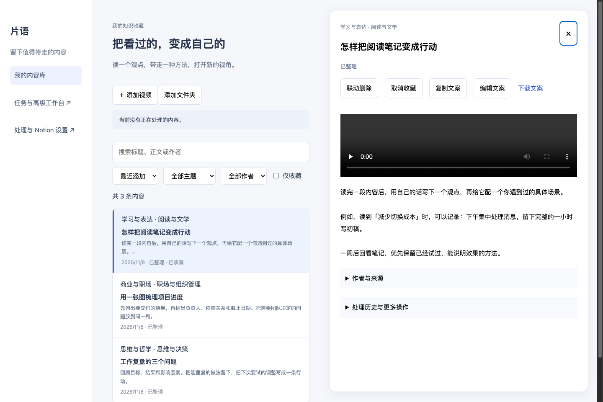
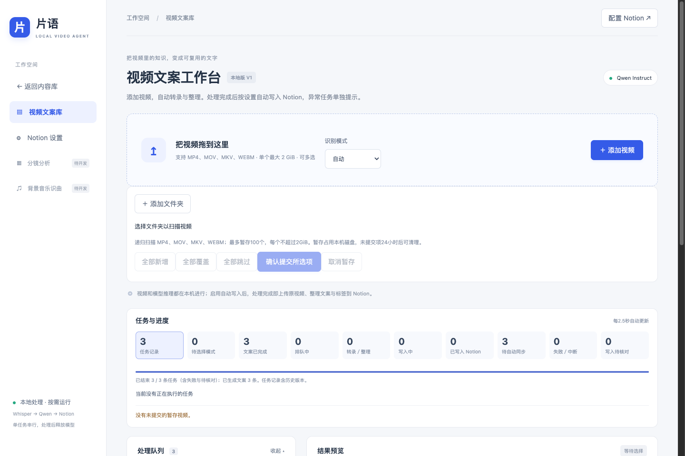

# 片语 Pianyu · Mac 本地视频文案工作台

片语是一个在 Apple Silicon Mac 上运行的视频文案工作台。导入本地视频或账号文件夹后，片语用 Whisper 转写口播、用本地 Qwen 整理文案与主题，也能在无有效口播时提取画面文字。结果可以在内容库里阅读、编辑和检索，也可以同步到自己的 Notion。

当前发行版为 **0.2.0 Preview**，适用于 macOS 15 或更新版本，使用原生 ARM64 Python 3.12。请从 [GitHub Releases](https://github.com/Formangarden524/pianyu-mac/releases/latest) 下载包含安装脚本的 ZIP，首次安装时另行下载依赖和模型。

## 界面预览

**内容库**支持按标题、正文、主题和作者找内容。左侧选择条目，右侧查看整理稿和原视频，也可复制、编辑、收藏或打开关联的 Notion 页面。

**高级工作台**集中显示任务和进度，适合批量处理、调整识别模式、查看转录结果及生成知识卡片。Notion 设置也在这里。

## 首次安装

1. 解压到自己可写且长期保留的目录，例如 `~/Applications/Pianyu-Mac`。请勿放在 iCloud 同步目录；安装后不要随意移动目录（虚拟环境和钥匙串账户与路径有关）。
2. 安装原生 ARM64 Python 3.12：[Python 官网](https://www.python.org/downloads/macos/)。使用 Homebrew 的用户可运行 `brew install python@3.12`；无需同时安装两套。使用现有 Homebrew 时应满足其系统要求：[安装说明](https://docs.brew.sh/Installation)。
3. 安装并打开 [Ollama Mac 官方应用](https://ollama.com/download/mac)，要求0.12.7或更新版本。工作台不会使用云模型，不需要 Ollama 云账号。
4. 双击 `01-安装依赖.command`，再双击 `02-下载模型.command`。首次需要联网访问 PyPI、Hugging Face、Ollama 模型库；网络失败后修复网络再运行，不会删除已有数据。FFmpeg随Python依赖提供，无需另装系统FFmpeg。
5. 下载时选择8B或30B。8B权重约6.2GB，建议16GB以上内存试用；30B约20GB，建议32GB以上、64GB更从容。内存建议是预估，系统与其他软件也需占内存；8B尚未做完整效果验收。建议空闲磁盘至少30GB（8B）或60GB（30B），另留视频存储空间。
6. 双击 `03-启动工作台.command`，浏览器打开 http://127.0.0.1:8765/ 。如需同步 Notion，进入「处理与 Notion 设置」，填写自己的 Integration 与目标页面或数据库，保存并测试。未配置 Notion 时可在本地处理和查看文案。

如果 Finder 无法直接运行脚本，请在终端进入解压目录，依次运行 `bash 01-安装依赖.command`、`bash 02-下载模型.command`、`bash 03-启动工作台.command`。安全拦截时核对下载来源和文件内容后按系统提示处理；本包不会关闭系统安全保护。

## 日常使用

- 首页可直接添加视频或文件夹。导入时按文件内容跳过已添加的相同视频，显示新增、重复跳过和未导入的数量。独立的 JPG、MP3 会跳过。
- 自动识别优先使用有效口播，无有效口播时再判断画面文字。高级工作台支持手动指定口播、画面文字或软件演示模式。确实无法判断的任务可在高级工作台批量选择识别模式。
- 从账号文件夹导入时，片语使用视频所在文件夹名作为作者账号。配置 Notion 后，系统会在处理完成时自动同步文案和主题；数据库支持作者账号字段时也会同步账号。
- 文案可复制、编辑和下载。高级工作台可以生成并导出知识卡片。执行联动删除前，界面会列出涉及的本地记录、关联 Notion 页面和管理目录内匹配的原视频。
- 「04-运行状态.command」查看进程和队列。运行日志位于 outputs/desktop/。
- 「05-停止工作台.command」在有排队、处理、写入或卡片任务时会拒绝停止。空闲时可停止工作台，共享 Ollama 会继续运行。
- 同一台电脑只运行一份工作台（端口 8765）。端口占用时请先停止另一份实例。

## Notion 权限与数据

在 Notion 给 Integration 授权目标页面/数据库，需读取、插入、更新内容权限。如果同步到数据库，请准备「主题大类」「主题细分」字段，类型为 select 或 multi_select。旧版数据库升级后可以新增这两个字段，保留原来的标签字段。要同步作者时，可添加「作者账号」字段，支持 select、multi_select 或文本。原视频、整理稿、摘要关键词上传至你的 Notion；不写入原始转录。密钥仅存本机登录钥匙串，不写入配置文件。更换路径可能需要重新设置凭证。

原视频与任务数据库位于本目录 `outputs/video-agent/`，模型在 `runtimes/` 和 Ollama 模型目录。安装完成后识别、转录、整理不需要网络；下载和 Notion 同步需要网络。模型下载和设置应在无处理任务时进行，避免同时更换模型。

## 当前限制

仅 Apple Silicon Mac，暂不支持 Intel / Windows。使用串行任务避免多个模型争抢统一内存。画面文字每3秒采样，最多120帧；短暂文字可能遗漏，过长视频需分段。自动识别的口播判断主要参考前 30 秒语音。分镜、在线识曲仍是占位，不包含生图/视频生成模型。图片卡片依赖 macOS 自带 STHeiti Light 字体。

此版本提供源码安装包，包含安装和启动脚本。首次安装需联网获取依赖和模型。模型权重不随包分发，各依赖和模型遵循各自许可证。项目尚未指定开源许可证；本包不自动授予公开再分发许可，请联系项目维护者确认。

## 升级 / 备份 / 卸载

备份整个 `outputs`（包含个人视频和文案，请自行妥善保存）。升级时停止旧工作台，保留该目录数据，在原目录替换代码并重新运行安装依赖；不要把虚拟环境复制到另一路径。卸载前停止工作台、在设置中清除密钥；自行备份后移除解压目录。共享 Ollama、Python 及其其他模型不会被卸载。

## 模型来源

- https://ollama.com/library/qwen3-vl:8b-instruct
- https://ollama.com/library/qwen3-vl:30b-a3b-instruct
- https://huggingface.co/mlx-community/whisper-small-mlx
- https://docs.ollama.com/quickstart
